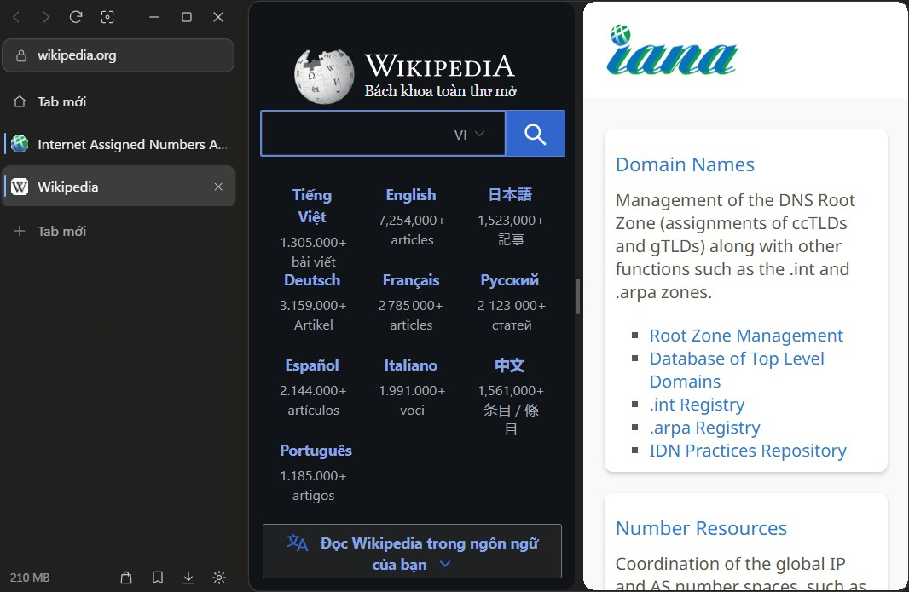

# Lụa Browser

Trình duyệt web cho Windows 11. Gọn, mượt, và chỉnh được gần như mọi thứ.

Lõi vẫn là Chromium như Edge và Chrome, nên trang nào cũng chạy bình thường. Khác ở phần bao quanh: giao diện tối giản, chặn quảng cáo sẵn, làm nhiều việc cùng lúc không rối.

**[Tải bản mới nhất](https://github.com/leverisxvn/lua-browser-releases/releases/latest)**

## Có gì

| Khi bạn muốn | Lụa có |
|---|---|
| Duyệt web gọn gàng | Tab dọc hoặc ngang, thanh công cụ tự ẩn |
| Làm gì cũng nhanh | `Ctrl K`: tìm web, mở trang, chuyển tab, tính nhanh chỉ trong một ô |
| Bớt quảng cáo | Chặn sẵn quảng cáo và trình theo dõi, không cần cài thêm |
| Làm nhiều việc | Chia đôi màn hình, không gian làm việc, kéo tab ra thành cửa sổ riêng |
| Xem video đã hơn | Khung video nhỏ, video đầy cửa sổ, ánh sáng nền trên YouTube |
| Không bị phân tâm | Chế độ tập trung `Alt F` |
| Đọc tiếng nước ngoài | `Alt T`: dịch đoạn đang chọn hoặc cả trang |
| Làm theo ý mình | 41 theme, Liquid Glass, font, âm thanh, phím tắt, tiện ích, 20 ngôn ngữ |
| Duyệt riêng tư | Tab riêng tư `Ctrl Shift N` |

## Cài đặt

1. Tải `LuaSetup-x.y.z.exe` ở trang [Releases](https://github.com/leverisxvn/lua-browser-releases/releases/latest).
2. Mở file để cài. Không cần quyền admin, không cần cài thêm gì.
3. Windows cảnh báo thì bấm **More info → Run anyway**. Bộ cài chưa có chữ ký số nên mới hiện như vậy.

Có bản mới, Lụa tự tải về và kiểm tra, bạn chỉ cần bấm cài.

Cần Windows 11, bản 64-bit.
