# Lụa Browser

Trình duyệt web cho Windows 11. Gọn, mượt, và chỉnh được gần như mọi thứ.

Lõi vẫn là Chromium như Edge và Chrome, nên trang nào cũng chạy bình thường. Khác ở phần bao quanh: giao diện tối giản, chặn quảng cáo sẵn, làm nhiều việc cùng lúc không rối.

**[Tải bản mới nhất](https://github.com/leverisxvn/lua-browser-releases/releases/latest)** · Windows 11, 64-bit

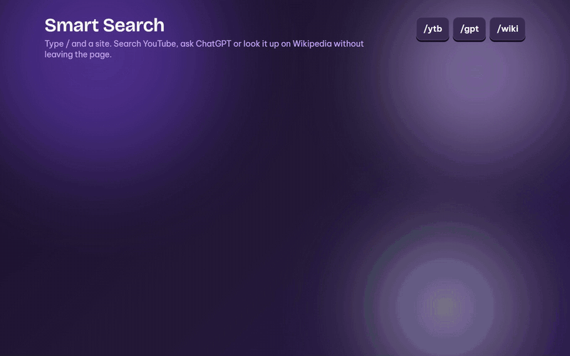

## Cài đặt

1. Tải `LuaSetup-x.y.z.exe` ở trang [Releases](https://github.com/leverisxvn/lua-browser-releases/releases/latest).
2. Mở file để cài. Không cần quyền admin, không cần cài thêm gì.
3. Windows cảnh báo thì bấm **More info → Run anyway**. Bộ cài chưa có chữ ký số nên mới hiện như vậy.

Có bản mới, Lụa tự tải về và kiểm tra, bạn chỉ cần bấm cài.

## Phím tắt chính

| Phím | Việc |
|---|---|
| `Ctrl K` | Bảng lệnh |
| `Alt F` | Chế độ tập trung |
| `Alt T` | Dịch trang hoặc đoạn đang chọn |
| `Alt V` | Video đầy cửa sổ |
| `Alt M` | Khung video nhỏ |
| `F11` | Toàn màn hình, vẫn giữ các thanh |
| `Ctrl \` | Chia đôi màn hình |
| `Ctrl Alt ←` `→` | Đổi không gian làm việc |
| `Ctrl Shift B` | Ẩn hoặc hiện thanh tab |
| `Ctrl Shift N` | Tab riêng tư |
| `Ctrl Shift S` | Lua Store |

Đổi phím nào cũng được, trong Settings > Shortcuts.

## Từng tính năng

Các animation dưới đây dựng theo giao diện tiếng Anh của Lụa. Trang web và tên kênh trong đó chỉ là ví dụ.

### Bảng lệnh

Một ô cho mọi việc: tìm web, mở trang, chuyển tab, ra lệnh với `>`, tính nhanh như `12*(3+4)`.

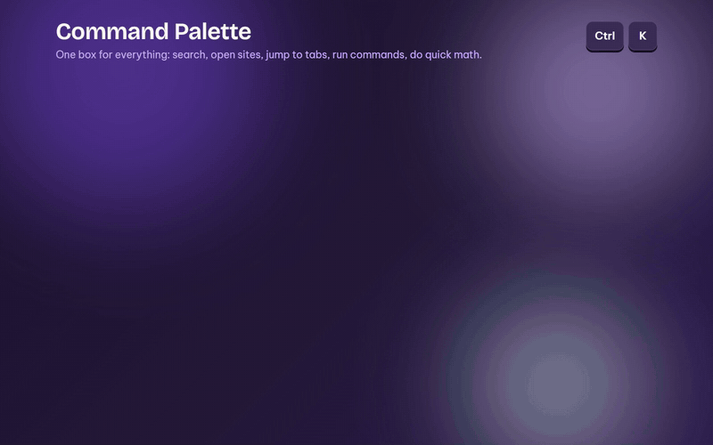

### Tìm kiếm thông minh

Gõ `/` rồi tên trang. `/ytb` tìm YouTube, `/gpt` hỏi ChatGPT, `/wiki` tra Wikipedia. Còn có `/claude`, `/gemini`, `/gh`, `/npm`, `/reddit` và nhiều trang khác. Các trang AI cần đăng nhập trước.

### Chế độ tập trung

Ẩn hết, chỉ còn trang web. Đưa chuột ra mép cửa sổ là thấy lại thanh tab.

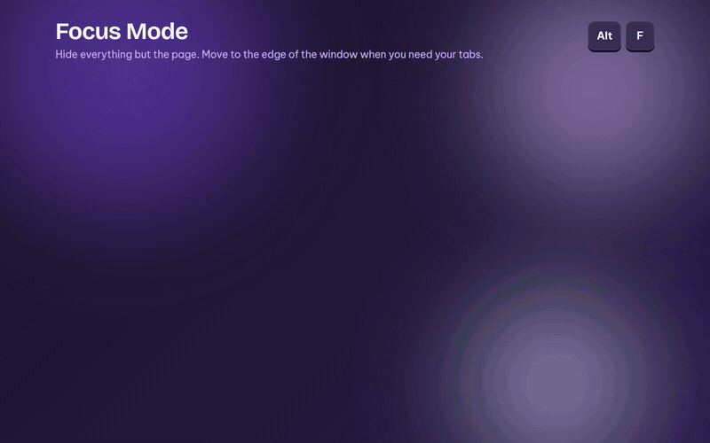

### Dịch trang

Dịch ngay trên trang, bố cục giữ nguyên. Muốn xem lại bản gốc thì bấm một cái.

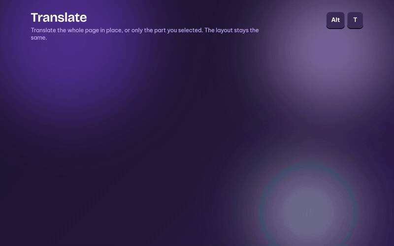

### Khiên chặn quảng cáo

Có sẵn, không cần cài thêm. Bốn mức: Off, Light, Clean, Total. Nên dùng Clean.

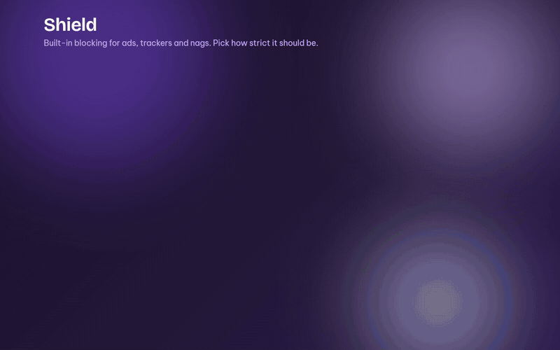

### Chia đôi màn hình

Hai trang cạnh nhau trong một cửa sổ. Kéo đường giữa để chia lại chỗ.

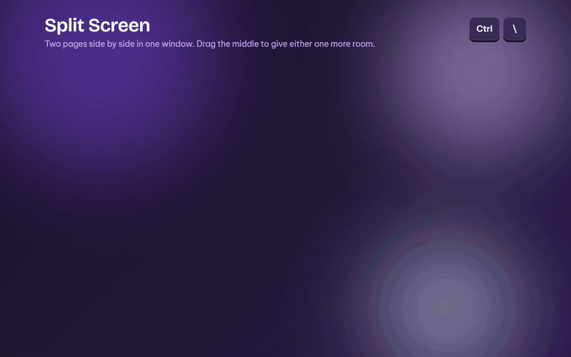

### Không gian làm việc

Mỗi không gian một bộ tab riêng, việc ra việc, chơi ra chơi.

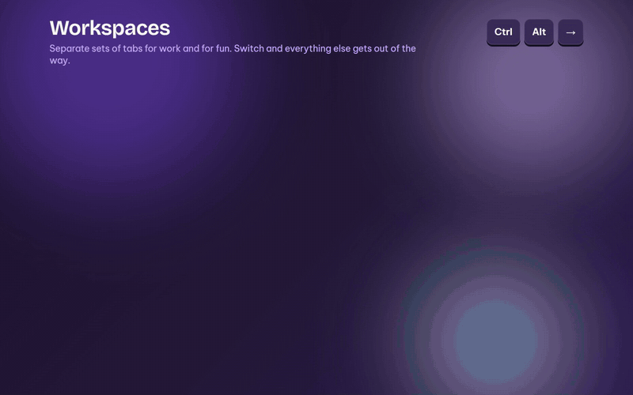

### Kéo tab ra cửa sổ riêng

Kéo tab ra là thành cửa sổ mới, trang vẫn chạy tiếp. Kéo về cũng vậy.

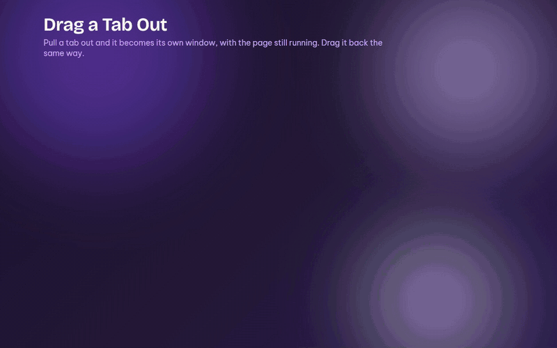

### Khung video nhỏ

Video chạy trong khung nhỏ để bạn làm việc khác.

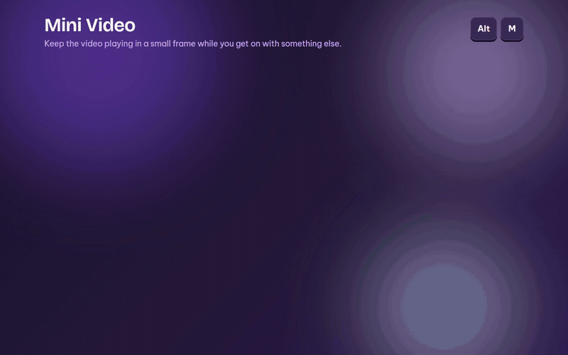

### Đầy cửa sổ, toàn màn hình

`Alt V` cho video đầy cửa sổ. `F11` phủ kín màn hình mà vẫn giữ các thanh.

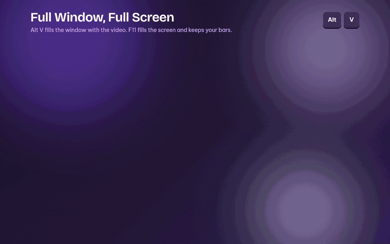

### Ánh sáng nền

Màu trong video toả ra quanh khung trên YouTube, tràn cả ra ngoài cửa sổ.

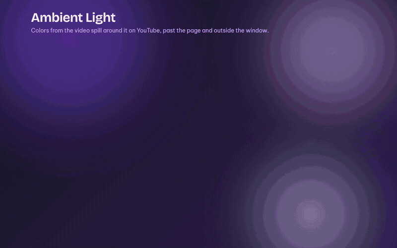

### Theme

43 theme, có cả Liquid Glass. Đổi được từng vùng màu và lưu thành theme của riêng bạn.

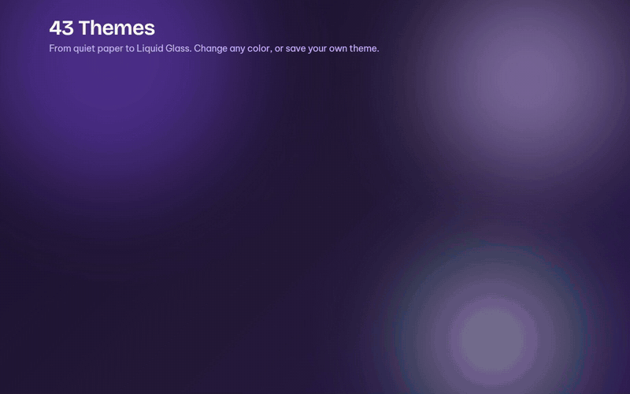

### Bố cục

Thanh tab bên trái, bên trên, bên phải, hoặc giấu hẳn đi.

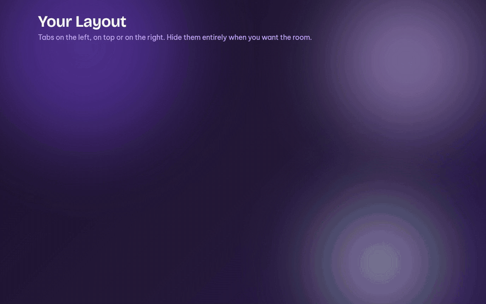

### Tab riêng tư

Đóng tab là xong, không để lại gì trong lịch sử.

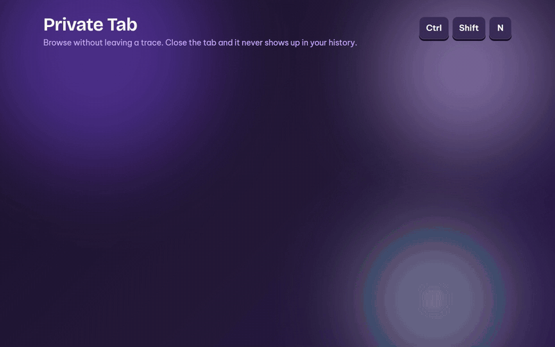

### Lua Store

Gói, theme, font, âm thanh, chữ ký và tiện ích, thêm chỉ với một cú bấm.

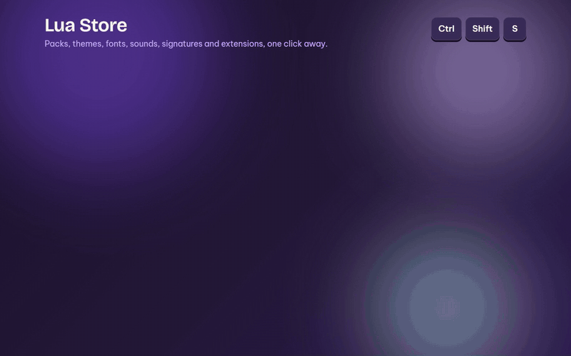
